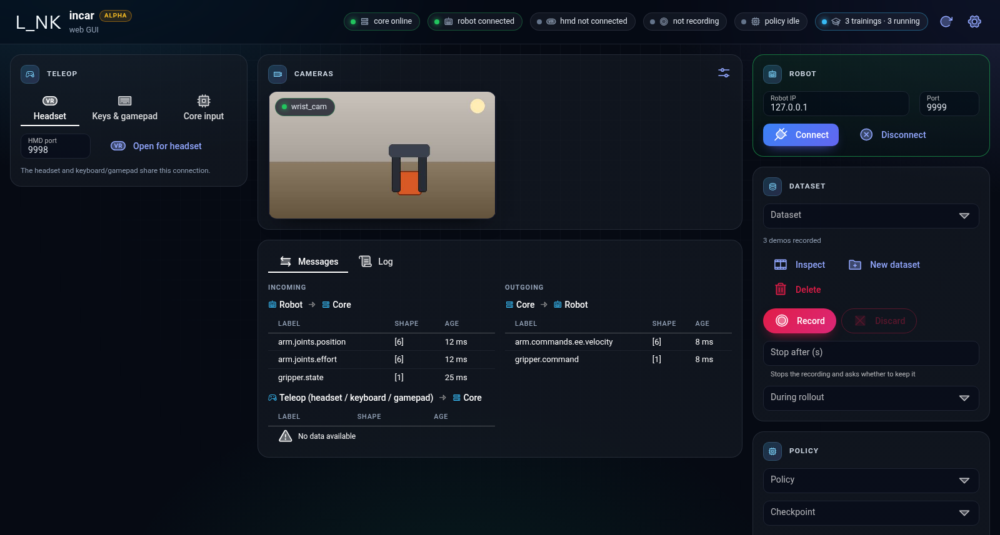
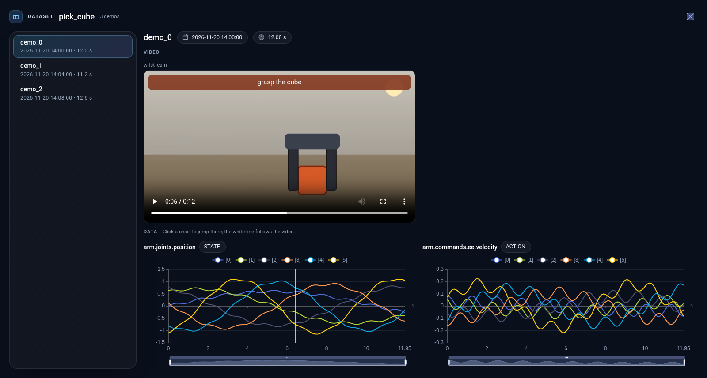
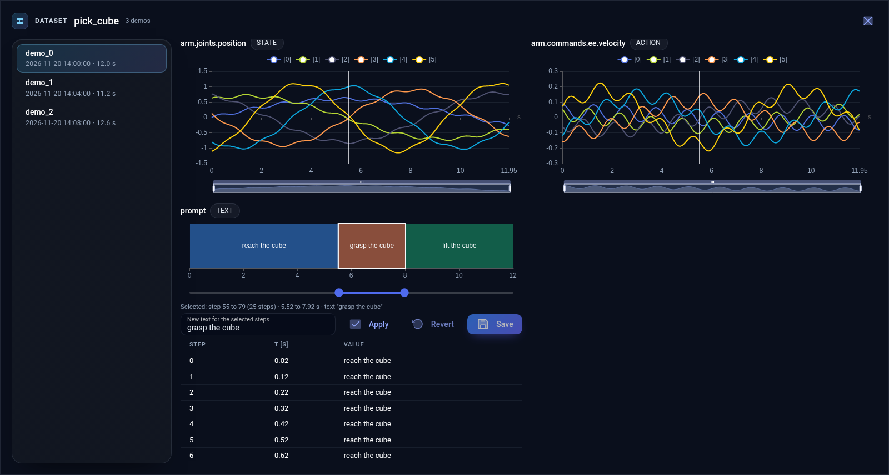
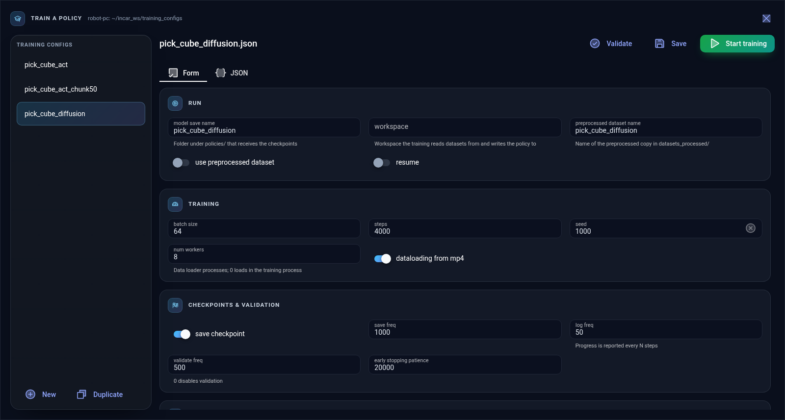
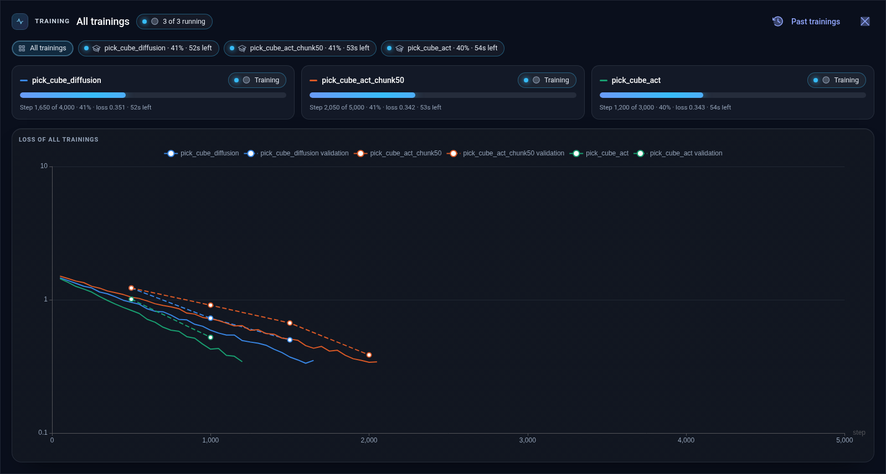

# incar web GUI

A browser GUI for the INCAR robotics platform, built with [NiceGUI](https://nicegui.io).
It covers everything the original INCAR GUI does and adds dataset inspection and editing, a training workbench and
remote control of an INCAR PC over SSH.



## Features

- **Teleoperation**: headset pairing via QR code (XR Commander), keyboard and gamepad control, core input devices and prompts
- **Live view**: camera streams at full frame rate, robot and headset status, incoming and outgoing messages, the core log
- **Datasets**: record with an optional fixed length, create and delete datasets, manage cameras
- **Dataset inspector**: play demos with video and charts in sync, and edit text features such as the prompt for single steps or whole ranges on a timeline
- **Training**: schema-based config editor (form + JSON) with explanations for every preprocessing step, parallel trainings with live progress, a combined view and past runs
- **Policies**: load, run and edit a checkpoint's settings
- **Remote PC**: run INCAR on another machine and use it over SSH, with saved connection setups

| Dataset inspector | Prompt editor |
|---|---|
|  |  |
| **Training editor** | **Parallel trainings** |
|  |  |

## Setup

The GUI runs next to an existing INCAR installation, in its own virtual environment that reuses INCAR's packages
(NiceGUI's event loop must not end up in INCAR's own server).

```bash
python3 -m venv .venv
.venv/bin/pip install nicegui segno httpx
# make INCAR's packages (incar_networking, numpy, h5py, ...) visible to this venv
echo /path/to/incar/venv/lib/python3.13/site-packages > .venv/lib/python3.13/site-packages/incar_venv.pth
.venv/bin/python app.py
```

Then open http://127.0.0.1:8090 while the INCAR core is running. The incar PC, the API key and the workspace are set
under **Settings** (gear icon, top right).

| Environment variable | Default | Purpose |
|---|---|---|
| `INCAR_URL` | `http://127.0.0.1:8000` | core address for a local INCAR |
| `INCAR_API_KEY` | `incar_admin` | core API key (can also be set in Settings) |
| `GUI_HOST` / `GUI_PORT` | `127.0.0.1` / `8090` | where the GUI listens |
| `INCAR_GUI_SSH_OPTS` | | extra `ssh` options for remote mode |
| `TRAIN_SIMULATION=1` | | start a log-only training stand-in instead of `incar train` (with `SIM_SECONDS`) |

**Remote PC:** choose *Remote PC over SSH* in Settings. Logging in must work without a password prompt (SSH key), and
the headset and keyboard teleop need network access to that PC.

**Headset:** open [teleop.incar-robotics.se](https://teleop.incar-robotics.se) on the headset, select the XR Commander
and scan the QR code from *Open for headset*. The headset must reach this PC on port 8765.

## Tests

```bash
.venv/bin/python test_app.py
```

A self-check of the status decoding, the training process handling, the SSH helpers, headset pairing and dataset
editing. It needs no robot and no running core.

## Credits

Built by Philipp with Claude. Icons: [Phosphor](https://phosphoricons.com) (MIT). Font: Wix Madefor Text (SIL OFL).
Licensed under the MIT License, see [LICENSE](LICENSE).
